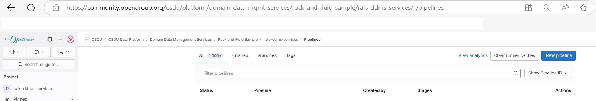
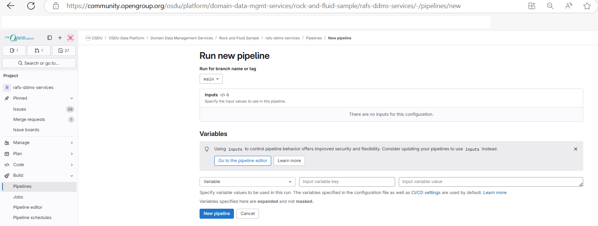
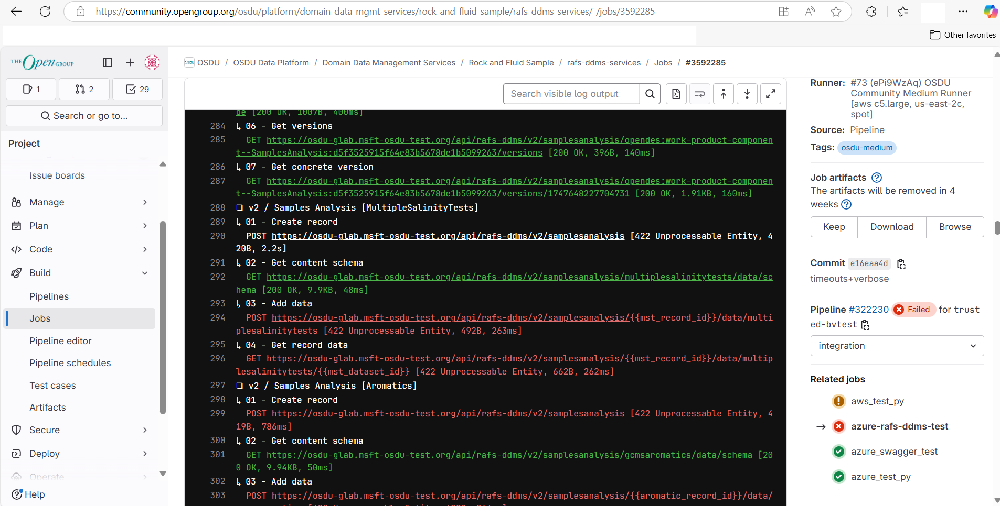
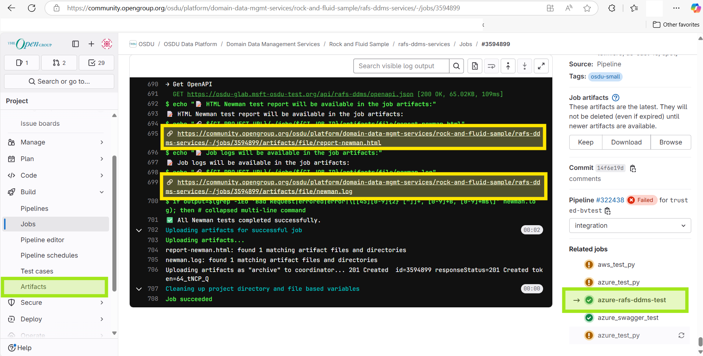

# Running Postman collection via Newman

- [☁️ Azure](#️-azure)
  - [Purpose](#purpose)
  - [Running tests](#running-tests)
  - [Manual pipeline execution](#manual-pipeline-execution)
  - [Output and Artifacts](#output-and-artifacts)
  - [Adding a new Postman collection to CI](#adding-a-new-postman-collection-to-ci)
  - [Additional information](#additional-information)

## ☁️ Azure

### Purpose

This pipeline is designed to run Postman collections using Newman with an HTML report generated via htmlextra.
It is designed for the AZURE_GLAB environment and verifies that the RAFS-DDMS API is working properly.

### Running tests

The `azure-rafs-ddms-test` job runs **only when the pipeline is triggered in Azure context**, specifically when:

- The environment variable `AZURE` is set to `"1"`
- And `AZURE_SKIP_DEPLOY` is not `"true"`

You can also trigger the pipeline manually:

### Manual pipeline execution

To manually start the pipeline, go to the [**CI/CD → Pipelines**](https://community.opengroup.org/osdu/platform/domain-data-mgmt-services/rock-and-fluid-sample/rafs-ddms-services/-/pipelines "CI/CD → Pipelines"):


Then click on [**New Pipeline**](https://community.opengroup.org/osdu/platform/domain-data-mgmt-services/rock-and-fluid-sample/rafs-ddms-services/-/pipelines/new "New Pipeline") at the top right corner, and then you can launch the pipeline:


No additional variables or files are required — the defaults are pre-configured.

### Output and Artifacts

Each job produces:

- 📄 `report-newman.html` – detailed HTML test report in htmlextra format

- 📝 `newman.log` – raw CLI output with full request/response trace

- 🔍 A colorized shortened test summary is displayed directly in the GitLab job log, highlighting HTTP errors like 401 Unauthorized or 400 Bad Request in red, and successful requests (e.g., 200 OK, 201 Created) in green for quick diagnostics.


⚠️ If any request in the Postman collection fails, the job is explicitly marked as failed by parsing newman.log for known error patterns. This ensures that testing errors will never be ignored.

📎 Both artifacts (report-newman.html and newman.log) are archived and available for download from the GitLab  CI/CD → Jobs → [Specific Job] → Artifacts.

✅ For convenience, direct links to the artifacts are also echoed at the end of the GitLab job log:


### Adding a new Postman collection to CI

To test a new collection:

- Save your Postman collection to:
./tests/qa/Postman Collection/Collection/`NEW_COLLECTION_NAME.postman_collection.json`
- Add a new job in `newman-test.gitlab-ci.yml`:

```yaml
NEW-tests:
  extends: .newman_rafs_tests
  variables:
    #Leave as is
    ENVIRONMENT: "./tests/qa/Postman Collection/Environment/OSDU_AZURE_GLAB.postman_environment.json"
    #Should be configured
    COLLECTION_JSON: "./tests/qa/Postman Collection/Collection/NEW_COLLECTION_NAME.postman_collection.json"
```

- Commit and push your changes, then create a branch starting with `trusted-` – the pipeline will trigger automatically.

### Additional information

Some variables (CLIENT_ID, CLIENT_SECRET, and TENANT_ID) required to run the collection are defined as protected GitLab CI/CD variables and are not included in the Postman environment files for security reasons.

Currently, the following variables are configured in **Settings → CI/CD → Variables**:

- `TEST_AZURE_APP_ID` (maps to `CLIENT_ID`)
- `TEST_AZURE_APP_SECRET` (maps to `CLIENT_SECRET`)
- `TEST_AZURE_TENANT_ID` (maps to `TENANT_ID`)
