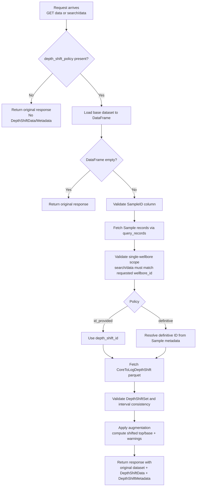
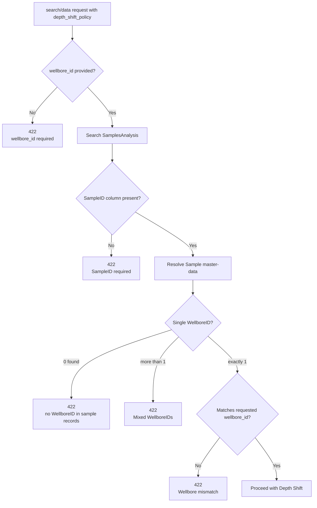
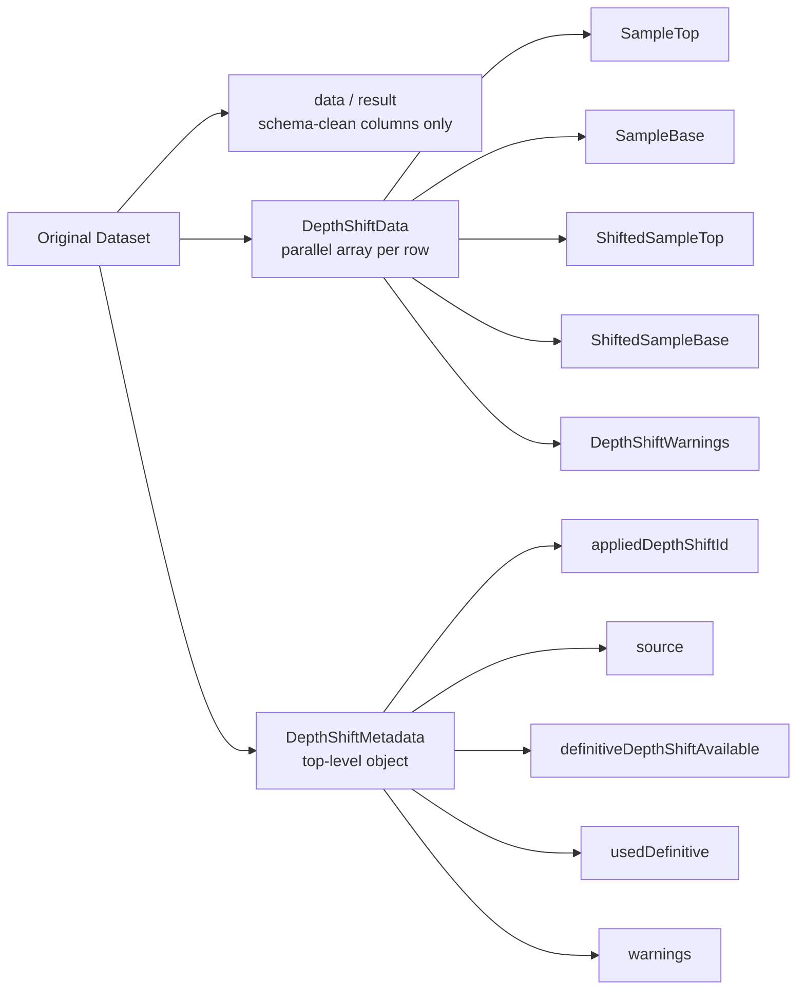

# Depth-Shift Functionality for GET Data and Search Data

This document describes the end-to-end depth-shift behavior for the two v2 SamplesAnalysis read paths:

* **GET data endpoint**
  * `/api/rafs-ddms/v2/samplesanalysis/{record_id}/data/{analysis_type}/{content_id}`

* **search/data endpoint**
  * `/api/rafs-ddms/v2/samplesanalysis/{analysis_type}/search/data`

---

# Purpose

Depth-shift augments SamplesAnalysis results with derived shifted depths without modifying the original bulk-data schema.

When enabled, RAFS returns:

* Original payload data in `data` (GET) or `result` (search/data)
* Parallel row-level depth-shift output in `DepthShiftData`
* Top-level status, provenance, and warnings in `DepthShiftMetadata`

The original schema remains unchanged.

---

# Depth-Shift is Explicit (Opt-In)

RAFS **never applies depth shift automatically**.

If no `depth_shift_policy` is provided:

* Original data is returned unchanged.
* No `DepthShiftData` is added.
* No definitive depth shift is automatically applied, even if a definitive depth shift exists in Sample metadata.

Depth-shift is only executed when explicitly requested by the caller.

---

# Depth-Shift Flow Diagram



---

# Query Parameters

Depth-shift is controlled through query parameters.

## depth_shift_policy

Determines how RAFS resolves the DepthShift WPC.

Supported values:

* `id_provided`
* `definitive`

### id_provided

Use the caller-provided DepthShift WPC ID.

Requires `depth_shift_id=<DepthShiftWPCID>`.

### definitive

Resolve the DepthShift WPC from the associated Sample master-data.

RAFS looks for:

```
data.DefinitiveDepthShift.DefinitiveDepthShiftID
```

or:

```
data.DefinitiveDepthShiftID
```

If no definitive depth shift exists, `422 Unprocessable Entity` is returned.

---

## depth_shift_id

Required only when `depth_shift_policy=id_provided`. Ignored when `depth_shift_policy=definitive`.

---

# Query Parameter Validation

| Condition                              | Status |
| -------------------------------------- | -----: |
| Invalid parameter combinations         |    400 |
| Missing required parameter             |    400 |
| Definitive depth shift not found       |    422 |
| Ambiguous Sample mapping               |    422 |
| Missing SampleID in non-empty response |    422 |
| Mixed WellboreIDs                      |    422 |
| Requested wellbore mismatch            |    422 |

---

# GET Data Endpoint Behavior

Endpoint:

```
/api/rafs-ddms/v2/samplesanalysis/{record_id}/data/{analysis_type}/{content_id}
```

Rules:

* Without `depth_shift_policy`, behavior is unchanged.
* Empty base dataframe returns original response unchanged.
* Missing `SampleID` column returns `422`.
* Supports `orient=split` and `orient=records`.
* Depth-shift validation errors return `422`.
* Missing referenced resources return `404`.
* Invalid parameter combinations return `400`.

---

# search/data Endpoint Behavior

Endpoint:

```
/api/rafs-ddms/v2/samplesanalysis/{analysis_type}/search/data
```

Rules:

* Depth-shift is applied only when explicitly requested.
* Empty search results return the unchanged response.
* Non-empty results require `SampleID` column and `wellbore_id` scope.
* All resolved Samples must belong to a single Wellbore.
* The resolved Wellbore must match the requested `wellbore_id`; mismatch returns `422`.

---

# Search Scope and Depth-Shift Scoping Rules

Depth-shift on `search/data` requires a wellbore-scoped query. Only `wellbore_id` is accepted as the scoping parameter.



---

# Response Contract

## Response Structure



## Main Dataset Remains Schema-Clean

The following columns are intentionally excluded from `data` / `result` and returned only in `DepthShiftData`:

* `SampleTop`
* `SampleBase`
* `ShiftedSampleTop`
* `ShiftedSampleBase`
* `DepthShiftWarnings`

---

## DepthShiftData

Parallel array aligned by row index with the main dataset. Each item:

```json
{
  "SampleTop": 1872.0,
  "SampleBase": 1873.0,
  "ShiftedSampleTop": 1878.5,
  "ShiftedSampleBase": 1879.5,
  "DepthShiftWarnings": []
}
```

---

## DepthShiftMetadata

Top-level metadata describing the applied shift:

```json
{
  "appliedDepthShiftId": "partition:work-product-component--DepthShift:shift-1:",
  "source": "definitive",
  "definitiveDepthShiftAvailable": true,
  "usedDefinitive": true,
  "warnings": []
}
```

Fields:

* `appliedDepthShiftId`
* `source`: `definitive` or `user-provided`
* `definitiveDepthShiftAvailable`
* `usedDefinitive`
* `warnings`

---

# Warnings

Warnings are informational and do not fail the request.

### User-provided ID differs from definitive

```
User provided DepthShiftID differs from the Sample definitive DepthShiftID.
```

RAFS still applies the user-provided DepthShift.

### Non-Driller depth source

```
VerticalMeasurementSourceID is 'Wireline'.
This Sample may not need to be shifted.
Please validate Sample depth information.
```

Depth-shift proceeds.

### Sample outside shift intervals

```
Sample not shifted: SampleTop falls outside all shift intervals.
```

Depth-shift does not fail. In this case `ShiftedSampleTop = SampleTop` and `ShiftedSampleBase = SampleBase`.

---

# Interval Boundary Rule

DepthShift intervals use half-open evaluation: `[OriginalTopDepth, OriginalBaseDepth)`

Meaning: `OriginalTopDepth <= SampleTop < OriginalBaseDepth`

## Shared Boundaries

Shared boundaries are allowed. For adjacent intervals `[1870,1900)` and `[1900,1930)`, a sample at `SampleTop=1900` selects the second interval.

## Overlapping Intervals

Overlapping intervals are invalid and return `422 Unprocessable Entity`.

---

# Interpolation Rules

RAFS supports constant-offset (bulk shift) and linear interpolation.

## InterpolationMethodID = None

RAFS auto-selects behavior:

* Original span == Shifted span → bulk shift
* Original span != Shifted span → linear interpolation

## InterpolationMethodID = Linear

Linear interpolation is used. Sample length may change proportionally to the interval transformation.

## InterpolationMethodID = Bilinear

Not supported. Returns `422 Unprocessable Entity` because bilinear requires multiple dimensions.

---

# Definitive Depth Shift Resolution

RAFS supports both Sample record layouts:

* Nested: `data.DefinitiveDepthShift.DefinitiveDepthShiftID`
* Flat: `data.DefinitiveDepthShiftID`

When `depth_shift_policy=id_provided` and a different definitive ID exists in sample metadata, RAFS applies the user-provided DepthShift and emits a warning in `DepthShiftMetadata.warnings`.

---

# Example Requests

Replace placeholder values before running these requests:

* `{BASE_URL}`: RAFS base path such as `https://<host>/api/rafs-ddms/v2`
* `{TOKEN}`: Bearer token
* `{PARTITION}`: OSDU data partition
* `{SA_RECORD_ID}`: SamplesAnalysis record ID
* `{ANALYSIS_TYPE}`: Analysis type path segment such as `routinecoreanalysis`
* `{CONTENT_ID}`: Dataset/blob content ID
* `{DEPTH_SHIFT_WPC_ID}`: DepthShift WPC record ID
* `{WELLBORE_ID}`: Wellbore record ID for scoped search/data

---

## GET data without DepthShift

```bash
curl --location --globoff \
'{BASE_URL}/samplesanalysis/{SA_RECORD_ID}/data/{ANALYSIS_TYPE}/{CONTENT_ID}?content_schema_version=1.0.0' \
  --header 'Authorization: Bearer {TOKEN}' \
  --header 'data-partition-id: {PARTITION}' \
  --header 'Accept: application/json'
```

Returns:

- Original payload only.
- No `DepthShiftData`.
- No `DepthShiftMetadata`.

---

## GET data with user-provided DepthShift

```bash
curl --location --globoff \
'{BASE_URL}/samplesanalysis/{SA_RECORD_ID}/data/{ANALYSIS_TYPE}/{CONTENT_ID}?depth_shift_policy=id_provided&depth_shift_id={DEPTH_SHIFT_WPC_ID}&content_schema_version=1.0.0' \
  --header 'Authorization: Bearer {TOKEN}' \
  --header 'data-partition-id: {PARTITION}' \
  --header 'Accept: application/json'
```

---

## GET data with definitive DepthShift

```bash
curl --location --globoff \
'{BASE_URL}/samplesanalysis/{SA_RECORD_ID}/data/{ANALYSIS_TYPE}/{CONTENT_ID}?depth_shift_policy=definitive&content_schema_version=1.0.0' \
  --header 'Authorization: Bearer {TOKEN}' \
  --header 'data-partition-id: {PARTITION}' \
  --header 'Accept: application/json'
```

RAFS resolves the `DefinitiveDepthShiftID` from the associated Sample record.

---

## search/data without DepthShift

```bash
curl --location --globoff \
'{BASE_URL}/samplesanalysis/{ANALYSIS_TYPE}/search/data?wellbore_id={WELLBORE_ID}&content_schema_version=1.0.0' \
  --header 'Authorization: Bearer {TOKEN}' \
  --header 'data-partition-id: {PARTITION}' \
  --header 'Accept: application/json'
```

Returns:

- Original search response only.
- No `DepthShiftData`.
- No `DepthShiftMetadata`.

---

## search/data with user-provided DepthShift

```bash
curl --location --globoff \
'{BASE_URL}/samplesanalysis/{ANALYSIS_TYPE}/search/data?depth_shift_policy=id_provided&depth_shift_id={DEPTH_SHIFT_WPC_ID}&wellbore_id={WELLBORE_ID}&content_schema_version=1.0.0' \
  --header 'Authorization: Bearer {TOKEN}' \
  --header 'data-partition-id: {PARTITION}' \
  --header 'Accept: application/json'
```

---

## search/data with definitive DepthShift

```bash
curl --location --globoff \
'{BASE_URL}/samplesanalysis/{ANALYSIS_TYPE}/search/data?depth_shift_policy=definitive&wellbore_id={WELLBORE_ID}&content_schema_version=1.0.0' \
  --header 'Authorization: Bearer {TOKEN}' \
  --header 'data-partition-id: {PARTITION}' \
  --header 'Accept: application/json'
```

RAFS resolves the `DefinitiveDepthShiftID` from the associated Sample record.

> **Note:** `wellbore_id` is required when depth-shift augmentation is requested on `search/data` so that RAFS can safely resolve a unique Sample and DepthShift context.
