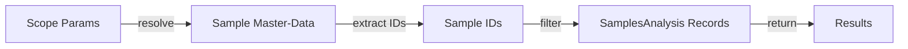

# Search Scope Filtering

Search scope parameters provide optional hierarchical filtering of RAFS DDMS search results across organizational levels. This document describes how scopes work, which scopes are available per endpoint type, and what master data must be populated for scopes to function.

---

## Overview

### What Are Search Scopes?

Search scopes are optional query parameters that filter results to specific organizational levels (Basin → Field → Well → Wellbore). They allow you to narrow search results from broad (basin-wide) to specific (wellbore-specific) without needing to modify search filter queries.

### Scope Hierarchy

Scopes follow an organizational hierarchy from broadest to most specific. Where supported by the endpoint, they are cumulative:

```
Basin (broadest)
  ↓
Field
  ↓
Well (SamplesAnalysis only)
  ↓
Wellbore (SamplesAnalysis & DepthShift only)
```

All scope parameters are **optional**, and you can combine them to further refine results:
- `basin_id` alone
- `basin_id` + `field_id`
- `basin_id` + `field_id` + `well_id` + `wellbore_id` (SamplesAnalysis only)

---

## Scope Parameters by Endpoint Type

### 1. SamplesAnalysis Endpoints

**4 Scope Parameters Supported:**
- `basin_id` — Basin master-data record ID
- `field_id` — Field master-data record ID
- `well_id` — Well master-data record ID
- `wellbore_id` — Wellbore master-data record ID

**Affected Endpoints:**
- `/v2/samplesanalysis/{analysis_type}/search`
- `/v2/samplesanalysis/{analysis_type}/search/data`

**Data Resolution:**
SamplesAnalysis uses a two-hop resolution strategy:
1. Resolve Sample master-data records based on `basin_id`, `field_id`, `well_id`, and `wellbore_id`
2. Filter SamplesAnalysis records by their associated Sample IDs

**Special Case - Depth-Shift:**
When using `depth_shift_policy` on the search/data endpoint, `wellbore_id` becomes required and all results must belong to a single wellbore. See [depth_shift_get_search_functionality.md](../depth-shift/depth_shift_get_search_functionality.md) for details.

---

### 2. DepthShift Endpoints

**3 Scope Parameters Supported:**
- `basin_id` — Basin master-data record ID
- `field_id` — Field master-data record ID
- `wellbore_id` — Wellbore master-data record ID (NO `well_id`)

**Affected Endpoints:**
- `/v2/depthshift/search`
- `/v2/depthshift/search/data`

**Data Resolution:**
DepthShift records expose `WellboreID` directly on record data, plus `BasinID` and `FieldID` via GeoContexts. They do not carry well-level scope, so `well_id` is not supported.

**Note:** `well_id` is not supported on DepthShift endpoints. Use `wellbore_id` for well-level scoping.

---

### 3. SaturationFunctionSet Endpoints

**2 Scope Parameters Supported:**
- `basin_id` — Basin master-data record ID
- `field_id` — Field master-data record ID

**Affected Endpoints:**
- `/v2/saturationfunctionset/search`
- `/v2/saturationfunctionset/search/data`

**Data Resolution:**
SaturationFunctionSet records carry GeoContexts only. Results are filtered by matching `BasinID` and `FieldID` in the record's GeoContexts array.

---

### 4. ReservoirSimulationRockPhysicsModel Endpoints

**2 Scope Parameters Supported:**
- `basin_id` — Basin master-data record ID
- `field_id` — Field master-data record ID

**Affected Endpoints:**
- `/v2/reservoirsimulationrockphysicsmodel/search`
- `/v2/reservoirsimulationrockphysicsmodel/search/data`

**Data Resolution:**
ReservoirSimulationRockPhysicsModel records carry GeoContexts only. Results are filtered by matching `BasinID` and `FieldID` in the record's GeoContexts array.

---

## Master Data Requirements

For scopes to work, the following master-data records must be created in OSDU **before** they are referenced in WPCs:

### Basin Record

OSDU Kind: `osdu:wks:master-data--Basin:1.0.0`

Example structure:
```json
{
  "id": "osdu:master-data--Basin:field-123:",
  "type": "Record",
  "kind": "osdu:wks:master-data--Basin:1.0.0",
  "data": {
    "BasinName": "North Sea"
  }
}
```

**Referenced By:** All scope types via `basin_id` parameter

---

### Field Record

OSDU Kind: `osdu:wks:master-data--Field:1.0.0`

Example structure:
```json
{
  "id": "osdu:master-data--Field:field-456:",
  "type": "Record",
  "kind": "osdu:wks:master-data--Field:1.0.0",
  "data": {
    "FieldName": "Kentish Knock South"
  }
}
```

**Referenced By:** All scope types via `field_id` parameter

---

### Well Record

OSDU Kind: `osdu:wks:master-data--Well:1.0.0`

Example structure:
```json
{
  "id": "osdu:master-data--Well:well-789:",
  "type": "Record",
  "kind": "osdu:wks:master-data--Well:1.0.0",
  "data": {
    "WellName": "KKS-1",
    "BasinID": "osdu:master-data--Basin:field-123:",
    "FieldID": "osdu:master-data--Field:field-456:"
  }
}
```

**Referenced By:** SamplesAnalysis scope via `well_id` parameter

---

### Wellbore Record

OSDU Kind: `osdu:wks:master-data--Wellbore:1.0.0`

Example structure:
```json
{
  "id": "osdu:master-data--Wellbore:wellbore-101:",
  "type": "Record",
  "kind": "osdu:wks:master-data--Wellbore:1.0.0",
  "data": {
    "WellboreName": "KKS-1A",
    "WellID": "osdu:master-data--Well:well-789:",
    "BasinID": "osdu:master-data--Basin:field-123:",
    "FieldID": "osdu:master-data--Field:field-456:"
  }
}
```

**Referenced By:** SamplesAnalysis and DepthShift scope via `wellbore_id` parameter

---

## WPC Data Structure Requirements

For scopes to resolve correctly, WPCs must contain the appropriate reference fields:

### SamplesAnalysis WPC

Scopes resolve through Sample master-data. SamplesAnalysis must reference its associated Sample through the `data.SampleIDs` array. Under the RAFS ingestion convention, the array contains a single Sample ID.

```json
{
  "data": {
    "SampleIDs": [
      "opendes:master-data--Sample:sample-001:"
    ],
    "SampleAcquisition": {
      "SampleAcquisitionDetail": {
        "WellboreID": "opendes:master-data--Wellbore:wellbore-101:"
      }
    }
  }
}
```

**Note:** Per RAFS convention, each WPC references a single Sample. While the schema allows multiple SampleIDs, standard RAFS ingestion is 1 content schema : 1 WPC : 1 Sample.

**Scope Resolution Path:**
1. User requests: `GET /v2/samplesanalysis/relativepermeability/search?wellbore_id=...`
2. RAFS resolves Sample records with matching `WellboreID`
3. RAFS filters SamplesAnalysis records with these Sample IDs

---

### DepthShift WPC

DepthShift records must carry wellbore information directly in `data`:

```json
{
  "data": {
    "WellboreID": "opendes:master-data--Wellbore:wellbore-101:",
    "GeoContexts": [
      {
        "BasinID": "opendes:master-data--Basin:field-123:",
        "FieldID": "opendes:master-data--Field:field-456:"
      }
    ]
  }
}
```

**Scope Resolution Path:**
1. User requests: `GET /v2/depthshift/search?wellbore_id=...`
2. RAFS filters DepthShift records where `data.WellboreID` matches the requested `wellbore_id`

---

### SaturationFunctionSet WPC

SaturationFunctionSet records must carry GeoContexts for basin/field scoping:

```json
{
  "data": {
    "GeoContexts": [
      {
        "BasinID": "opendes:master-data--Basin:field-123:",
        "FieldID": "opendes:master-data--Field:field-456:"
      }
    ]
  }
}
```

**Scope Resolution Path:**
1. User requests: `GET /v2/saturationfunctionset/search?basin_id=...&field_id=...`
2. RAFS filters records where `data.GeoContexts` contains matching `BasinID` and `FieldID`

---

### ReservoirSimulationRockPhysicsModel WPC

ReservoirSimulationRockPhysicsModel records must carry GeoContexts for basin/field scoping:

```json
{
  "data": {
    "GeoContexts": [
      {
        "BasinID": "opendes:master-data--Basin:field-123:",
        "FieldID": "opendes:master-data--Field:field-456:"
      }
    ]
  }
}
```

**Scope Resolution Path:**
1. User requests: `GET /v2/reservoirsimulationrockphysicsmodel/search?basin_id=...&field_id=...`
2. RAFS filters records where `data.GeoContexts` contains matching `BasinID` and `FieldID`

---

## Sample Master-Data

Sample records are crucial for SamplesAnalysis scope resolution. They must contain well/wellbore references:

```json
{
  "id": "opendes:master-data--Sample:sample-001:",
  "type": "Record",
  "kind": "osdu:wks:master-data--Sample:2.0.0",
  "data": {
    "WellID": "opendes:master-data--Well:well-789:",
    "WellboreID": "opendes:master-data--Wellbore:wellbore-101:",
    "BasinID": "opendes:master-data--Basin:field-123:",
    "FieldID": "opendes:master-data--Field:field-456:"
  }
}
```

**Why This Matters:**
- When you scope a SamplesAnalysis search by `wellbore_id`, RAFS must resolve Sample records with that `WellboreID`
- If Sample records don't have hierarchy ID fields, scope resolution will not work correctly

---

## Usage Examples

### Example 1: SamplesAnalysis Search by Field

**Request:**
```bash
GET /api/rafs-ddms/v2/samplesanalysis/relativepermeability/search?field_id=osdu:master-data--Field:field-456:
```

**Behavior:**
1. Resolve all Sample records with `FieldID = field-456`
2. Find all SamplesAnalysis records that reference these Samples
3. Return matching RelativePermeability results

**Data Requirements:**
- Field record must exist
- Sample records must have `FieldID` field
- SamplesAnalysis records must have `SampleIDs` referencing these Samples

---

### Example 2: DepthShift Search by Wellbore

**Request:**
```bash
GET /api/rafs-ddms/v2/depthshift/search?wellbore_id=osdu:master-data--Wellbore:wellbore-101:
```

**Behavior:**
1. Filter DepthShift records where `data.WellboreID = wellbore-101`
2. Return matching records

**Data Requirements:**
- Wellbore record must exist
- DepthShift records must have `data.WellboreID` field

---

### Example 3: SaturationFunctionSet Search by Basin and Field

**Request:**
```bash
GET /api/rafs-ddms/v2/saturationfunctionset/search?basin_id=osdu:master-data--Basin:field-123:&field_id=osdu:master-data--Field:field-456:
```

**Behavior:**
1. Filter records where `data.GeoContexts` contains **both** BasinID and FieldID
2. Return matching records

**Data Requirements:**
- Basin and Field records must exist
- SaturationFunctionSet records must have `data.GeoContexts[].BasinID` and `data.GeoContexts[].FieldID`

---

### Example 4: Combined Scope Search

**Request:**
```bash
GET /api/rafs-ddms/v2/samplesanalysis/relativepermeability/search?basin_id=osdu:master-data--Basin:field-123:&field_id=osdu:master-data--Field:field-456:&wellbore_id=osdu:master-data--Wellbore:wellbore-101:
```

**Behavior:**
1. Resolve Sample records matching **all three** criteria
2. Filter SamplesAnalysis by those Samples
3. Return matching RelativePermeability records

**Data Requirements:**
- All three master-data records must exist
- Sample records must have all three ID fields
- SamplesAnalysis records must reference these Samples

---

## Error Handling

### 400 Bad Request

Returned when:
- Scope parameters are invalid (malformed record ID format)
- Invalid parameter combinations

Example:
```json
{
  "detail": "Invalid basin_id format. Must match pattern: ^[\\w\\-\\.]+:master-data--Basin:[\\w\\-\\.:\\%]+$"
}
```

### 404 Not Found

Returned when:
- Referenced master-data record doesn't exist

### 422 Unprocessable Entity

Returned when:
- Scope resolution produces ambiguous results
- Depth-shift scoping rules are violated (e.g., mixed wellbore IDs)

See [depth_shift_get_search_functionality.md](../depth-shift/depth_shift_get_search_functionality.md) for depth-shift specific errors.

---

## Implementation Details

### Scope Parameter Format

All scope parameters must be valid OSDU record IDs following this pattern:

```
<partition>:<entity-type>:<identifier>:<version>
```

Examples:
- `osdu:master-data--Basin:north-sea:`
- `osdu:master-data--Field:field-123:1673921980922175`
- `opendes:master-data--Well:KKS-1:`

The version portion can be:
- Empty (latest version): `osdu:master-data--Well:KKS-1:`
- Numeric timestamp: `osdu:master-data--Well:KKS-1:1673921980922175`

### Multi-Hop Resolution

For SamplesAnalysis, scope filtering uses multi-hop resolution:



This two-hop approach ensures that:
- SamplesAnalysis results are correctly filtered by organizational hierarchy
- Well/wellbore references are enforced through Sample records
- Results maintain data integrity through master-data validation

---

## Best Practices

1. **Always create master-data records first** before creating WPCs that reference them

2. **Keep master-data relationships consistent**:
   - Sample records should have all hierarchy IDs (BasinID, FieldID, WellID, WellboreID)
   - WPC records should have complete GeoContexts where applicable

3. **Use the most specific scope available** to narrow results:
   - Prefer `wellbore_id` over `field_id` when possible
   - This reduces search overhead and provides more predictable results

4. **Combine scopes with filter queries** for fine-grained control:
   ```bash
   GET /v2/samplesanalysis/relativepermeability/search/data?
       wellbore_id=osdu:master-data--Wellbore:wellbore-101:&
       rows_filter=Temperature,gt,50
   ```

5. **Validate master-data before ingesting WPCs** to ensure scope resolution will work

---

## Related Documentation

- [OpenAPI Schema](../spec/openapi.json) — Complete API documentation
- [Depth-Shift Functionality](../depth-shift/depth_shift_get_search_functionality.md) — Depth-shift specific scoping rules
- [Tutorial](../tutorial/README.md) — Ingestion examples
